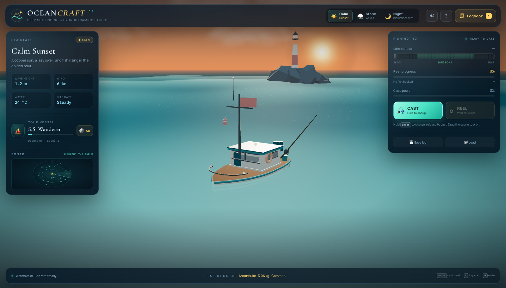

# OCEANCRAFT 3D

**Deep Sea Fishing & Hydrodynamics Studio** — a complete, production-ready, 100% client-side fishing game built with vanilla HTML5, CSS3, ES6 and Three.js r128.

[](https://somphol.github.io/oceancraft-3d/)
[](#)
[](#)
[](#verification)

> A copper sun, a lazy swell, and eighteen species waiting under the hull. **Cast into the blue.**



## Overview

OceanCraft 3D is a self-contained 3D fishing game and boat-physics toy. It renders an animated ocean with a custom wave field, floats a fully modelled fishing boat with sampled buoyancy, pitch and roll, and wraps a complete cast → bite → tension fight → catch → logbook loop in a marine-nautical glass UI.

Everything runs in the browser. There is no build step, server, database, API key or external art/audio pipeline. The water, boat, lighthouse, fish illustrations, sky, particles and soundscape are generated at runtime. Progress is saved to `localStorage` and can be exported to `oceancraft_save.json` and imported on another device.

## Live demo

<https://somphol.github.io/oceancraft-3d/>

If GitHub Pages is still warming up, serve the folder locally:

```bash
cd oceancraft-3d
python3 -m http.server 8765
# open http://localhost:8765/
```

## Features

### 3D ocean, sky and buoyancy

- Displacement-mapped ocean plane (380 × 380 units, up to 112 × 112 segments) driven by five interacting sine/cosine wave components.
- Vertex-coloured deep-water-to-crest gradient, foam highlights, a tiling procedural normal map and warm sun glints.
- **Boat buoyancy** samples wave height at four hull points every frame and applies damped vertical float, bow pitch, side roll and a gentle heading sway.
- Hand-built boat: tapered hull, wood-plank deck, wheelhouse with glowing windows, mast and flapping flag, outboard motor, rod and reel, life ring, crates, nav lights, lantern and wake decal.
- Distant lighthouse island with rotating beam, two bobbing buoys, seabirds, drifting clouds, a sun/moon, a 1,200-star field and bioluminescent plankton.
- Live environment interpolation between presets — sky gradient, fog, water colour, sun intensity, clouds, stars, rain and exposure all blend smoothly.

### Three sea states

| Preset | Mood | Waves | Notes |
| --- | --- | --- | --- |
| ☀️ **Calm Sunset** | Copper sky, easy swell | 1.2 m | Steady bite rate, warm sun path |
| ⛈️ **Stormy Waves** | Bruised sky, whitecaps | 3.1 m | 34 kn wind, rain, lightning, thunder, frenzied fish |
| 🌙 **Bioluminescent Night** | Blue hour, living light | 1.5 m | Moon, stars, glowing plankton, rare fish |

### Fishing loop

- **Hold to charge** the cast (mouse, touch, `Space` or `C`) and release to throw the bobber along a parabolic arc.
- Splash particles, expanding ripples and a taut/bowed fishing line that anchors to the rod tip.
- Fish bite after a randomized wait influenced by weather and the Glow Lure upgrade.
- **Tension reeling minigame**: hold `Reel`, `R` or `Space` to recover line while keeping the needle inside the green safe zone.
- Telegraphed **surges** that add tension; release the reel to ride them out.
- Line snap above 100% tension, fish escape on prolonged slack, and a full catch at 100% progress.
- Size, weight, rarity and reward are rolled per catch; legendary fish put up the hardest fights.

### Field guide, catches and records

- **18 species** across Common (8), Rare (6) and Legendary (4), each with a distinct procedural SVG illustration.
- Weight (kg), length (cm), rarity, weather, reward and catch timestamp recorded in the logbook.
- Personal bests per species, heaviest/longest/rarest records, total weight, lifetime coins, level and play time.
- **12 trophy badges** with automatic unlock toasts.
- Catch-reveal card with rarity glow, new-species marker, personal best, level-ups and badge unlocks.

### Boat & gear upgrades

Five permanent upgrade lines, purchased with catch coins:

| Upgrade | Effect |
| --- | --- |
| Carbon Cast Rod | +4 m cast range per level |
| Ball-Bearing Reel | +9% reel speed per level |
| Braided Kevlar Line | Wider safe zone, lower peak tension |
| Deep-Scan Sonar | Better rare & legendary odds |
| Glow Lure | Shorter bite waits |

Unlocked gear is visual too: a sonar dome appears on the wheelhouse and a bioluminescent lure glows at the rod tip.

### Persistence & file sync

- Autosave to `localStorage` every ~12 seconds, on catch, on upgrades, and when the tab is hidden.
- **💾 Save Aquarium Log** downloads `oceancraft_save.json`.
- **📂 Load Save File** validates and restores a log on any device.
- Progress includes catches, collection, bests, records, coins, XP, upgrades, badges and settings.

### Audio

All sound is synthesised with the Web Audio API:

- layered brown-noise ocean ambience with a slow LFO and weather-dependent filter,
- cast whoosh, splash, bite thump/chime, reel clicks, surge rumble, line snap, escape, thunder and catch fanfares,
- mute toggle (`M`) persisted with the save.

### Interface

- Marine nautical glassmorphism: slate-blue panels, sea-glass teal, brass/gold trophy accents and a serif display face.
- Responsive HUD: live sea-state readouts, vessel card, sonar canvas, tension/progress/cast meters and a two-button cast/reel dock.
- Full-screen logbook with Field Guide, Catches, Records & Badges, and Boat & Gear tabs.
- Mobile layout at 390 × 844 with a two-row top bar, large touch controls and a scrollable logbook.

## Controls

| Input | Action |
| --- | --- |
| **Hold Cast** / `Space` / `C` | Charge cast; release to throw |
| **Hold Reel** / `R` / `Space` (during a fight) | Reel in |
| Drag scene / scroll | Orbit / zoom camera |
| `L` | Open or close logbook |
| `M` | Mute / unmute |
| `?` or Help button | Controls & rules |
| `Esc` | Close modal |

## How to play

1. Hold **Cast** (or `Space`) to build power. Release to throw the bobber into open water.
2. Watch the bobber and sonar. A splash + chime means a fish has taken the lure.
3. Hold **Reel** to recover line. Keep the needle inside the green safe zone.
4. When **SURGE INCOMING** flashes, release the reel and let the tension fall.
5. Land the fish, read the catch card, then open the logbook to inspect your collection.
6. Spend coins in **Boat & gear** to reach deeper water and rarer species.
7. Use **Save log** / **Load** to move your aquarium between devices.

## Save format

```json
{
  "app": "OceanCraft 3D",
  "version": 1,
  "exportedAt": "2026-11-01T06:00:00.000Z",
  "save": {
    "version": 1,
    "profile": { "coins": 2480, "xp": 1680, "totalCatches": 20, "totalWeight": 367.2 },
    "catches": [
      { "speciesId": "golden-leviathan", "kg": 202.8, "cm": 344, "rarity": "legendary", "weather": "night" }
    ],
    "collection": { "golden-leviathan": { "count": 1, "bestKg": 202.8, "bestCm": 344 } },
    "upgrades": { "rod": 2, "reel": 2, "line": 2, "sonar": 2, "lure": 1 },
    "achievements": ["first-light", "first-legend"],
    "records": { "heaviest": { "name": "Golden Leviathan", "kg": 202.8 }, "rarest": { "rarity": "legendary" } },
    "settings": { "muted": false, "volume": 0.66 }
  }
}
```

Imported files are validated and normalized; malformed or future-version logs are rejected without touching the current save.

## Engineering notes

- **Wave field:** `h(x,z,t) = Σ sin/cos(k·p + ωt) · amplitude`, with weather-driven amplitude, choppiness and speed. The exact same function is sampled under the four hull points, so visuals and physics agree.
- **Buoyancy:** four local hull samples → average height, bow/stern pitch target and port/starboard roll target, all critically damped.
- **Tension:** target tension is a function of fish strength, reel input, surges and line upgrade; progress is paid out according to how close the needle sits to the centre of the safe zone. Above 100 snaps; prolonged slack lets the fish shake free.
- **No textures or audio files:** wood, boat nameplate, cloud, star, sun, moon, wake, particle, fish and UI art are generated with Canvas 2D / SVG; audio is synthesised with oscillators and noise buffers.
- **Performance:** 88 draw calls, ~30,400 triangles and ~2,500 points in the calm scene at 1600 × 1000 (headless software WebGL). The ocean segment count and pixel ratio step down on mobile.

## Verification

- **18/18 built-in self-tests pass.** Run `?selftest=1` or `OceanCraft.runSelfTests(true)` in the console.
- Headless Chrome 156 (WebGL via SwiftShader) verified:
  - cast charge → release → line flight → splash → waiting,
  - forced/real bite → reel hold → tension/progress meters,
  - line snap at high tension and auto re-rig,
  - slack-line escape and auto re-rig,
  - catch reveal, collection/record/achievement updates, XP and coins,
  - logbook tabs and gear purchases,
  - JSON export download (`oceancraft_save.json`) and real File import,
  - mute persistence across reload,
  - **0 uncaught exceptions** recorded by the app's built-in error capture (and no app-level console errors during the test run).
- Screenshots: calm (`screenshot.png`), storm, night, gameplay, logbook, legendary catch, mobile HUD and mobile logbook.

## Project structure

```
oceancraft-3d/
├── index.html
├── style.css
├── script.js
├── favicon.svg
├── screenshot.png
├── screenshot-storm.png
├── screenshot-night.png
├── screenshot-gameplay.png
├── screenshot-logbook.png
├── screenshot-catch.png
├── screenshot-mobile.png
├── screenshot-mobile-logbook.png
├── README.md
├── LICENSE
├── THIRD_PARTY_NOTICES.md
├── state.json
└── STATE.md
```

## Credits

Built with **[OpenCode](https://opencode.ai) 2.2.5** and **DeepSeek V4.1 Flash** (`opencode-go/deepseek-v4.1-flash`) in one agent session.

Runtime libraries: [Three.js](https://threejs.org/) r128 (MIT), OrbitControls from the Three.js r128 examples (MIT). Typefaces: **Cormorant Garamond**, **Manrope** and **IBM Plex Mono** from Google Fonts (SIL OFL 1.1). All scene art, fish illustrations, particles, water shader colours, boat model, UI and audio are generated in this project. See [THIRD_PARTY_NOTICES.md](THIRD_PARTY_NOTICES.md).

Build timing, token usage and session details are recorded in [STATE.md](STATE.md) and [state.json](state.json).

## License

[MIT](LICENSE) © 2026 Somphol Boonjing
